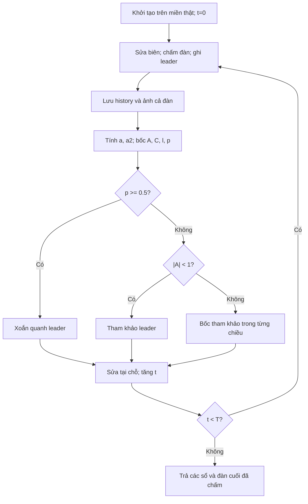

# Lõi mới giống mã tác giả đến đâu?

Bản trước là một cách cài theo ý tưởng WOA nhưng có những quy ước khác mã MATLAB của Seyedali Mirjalili. Bản này được đối chiếu trực tiếp với gói tải từ [trang WOA của tác giả](https://seyedalimirjalili.com/woa), đường tải được ghi trong `tham_khao_tac_gia/NGUON.md`. Mã MATLAB và license được giữ nguyên để thầy và nhóm cùng mở đối chiếu. Mình chưa có tên/ấn bản giáo trình thầy dùng, nên khẳng định ở đây là bám mã công bố của tác giả, không khẳng định trùng từng trang của một giáo trình chưa được cung cấp.

## Những chỗ đã chỉnh

| Chi tiết | Bản trước | Bản hiện tại theo WOA.m |
|---|---|---|
| A, C | Vô hướng từng cá voi | Giữ như vậy, đúng mã MATLAB |
| Chọn cá voi tham khảo | Một con cho cả mảng | Chọn lại bên trong vòng từng chiều j |
| Sửa đàn | Chụp đàn cũ, thay cả đàn mới | Sửa tại chỗ theo thứ tự i rồi j |
| a | Chia T-1, ép cuối về 0 | a=2-2*t/T |
| l | Luôn đều trong [-1,1] | a2=-1-t/T; l=(a2-1)*rand+1 |
| Biên | Sửa ngay sau bước cập nhật | Sửa ở đầu lượt chấm tiếp theo |
| Thứ tự | Chấm ban đầu rồi T lần sửa/chấm | T lượt: sửa biên, chấm đàn, ghi leader, cập nhật |
| Số lần chấm | N*(T+1) | N*T |
| Benchmark | Mảng 0..1 rồi giải mã về miền thật | Khởi tạo và cập nhật ngay trên miền thật |

Mã MATLAB tạo A/C/l bằng số vô hướng, dù bài báo trình bày A/C dạng vector. Bài báo mô tả l trong [-1,1], còn mã tải công bố dùng a2 để đáy khoảng lấy l đi dần từ -1 về gần -2. Bản này theo **mã MATLAB**, và ghi sự khác nhau để mình không vô tình trộn hai nguồn mô tả. Nguồn bài: [Mirjalili & Lewis, 2016](https://www.math.ucdavis.edu/~saito/data/PSO-ACO/mirjalili-lewis_whale-opt-alg.pdf).

Python và MATLAB không nhất thiết tạo đúng cùng dãy số khi gõ cùng seed. Mục tiêu đối chiếu là công thức, luật lấy số và thứ tự cập nhật; không tuyên bố hai môi trường cho cùng từng bit.

## Nói bằng một câu chuyện

Mỗi cá voi giữ một tờ phương án hoàn chỉnh. Máy chấm các tờ và cất tờ có J thấp nhất đã thấy vào sổ leader. Sau đó mỗi cá voi sửa các ô số của mình. Nó tung p: từ 0.5 trở lên thì dùng phương trình xoắn quanh leader; nhỏ hơn 0.5 thì xem A. Nếu |A|<1 thì tham khảo leader, nếu |A|>=1 thì hỏi một cá voi được bốc trong đàn.

Ở mỗi chiều j, nhánh không xoắn tính `D=abs(C*reference-whale[j])`, rồi `new=reference-A*D`. Nhánh xoắn tính `D=abs(leader[j]-whale[j])`, rồi `new=leader[j]+D*exp(b*l)*cos(2*pi*l)`. Bản cơ sở dùng cùng l trên các chiều của một con. Ngách l độc lập cho các chiều nhịp khác nhau; đó là phần thay toán tử của nhóm.

Mã tác giả hỏi con tham khảo ngay bên trong vòng j và sửa ngay vào đàn. Vì vậy một con ở sau có thể nhìn thấy một tọa độ đã được sửa của con trước. Nghe có vẻ là chi tiết nhỏ, nhưng nó làm hành vi khác với việc tất cả nhìn một bức ảnh đàn cũ. `n5_quynh_ngan_buoc_woa.py` giữ quy tắc ấy.

Khi hết một lượt sửa, chưa chấm ngay. Đầu lượt kế tiếp, tọa độ vượt miền được clip rồi mới chấm. Re-init là đối chứng thay clip: chỉ bốc lại tọa độ vượt biên, không xóa cả con. Hai hộp thẻ riêng dành cho re-init và l độc lập giúp không xáo trộn các r1/r2/p của bản cơ sở.

T bắt đầu từ t=0 đến T-1. Với N=30,T=800 có 24.000 lần chấm. Bước cập nhật cuối trong WOA.m không được chấm nữa, nên bản này cũng không đem đàn chưa chấm ấy báo thành kết quả. “Đàn cuối” trên ảnh là đàn cuối **đã được chấm**. Snapshot và sổ hợp lệ không tham gia thay công thức leader.

## Vì sao benchmark cũ cần thay?

WOA có `C*leader-x`. Nếu cùng dời mọi tọa độ một đoạn h, biểu thức bên trong sẽ có thêm `(C-1)*h`. Vậy dời gốc không chỉ đổi cách viết con số: nó có thể đổi bước tìm kiếm. Đưa Sphere/Rastrigin từ miền quanh 0 về 0..1 làm đáy chuyển sang 0.5, tạo ra một bài cài đặt khác với miền gốc tác giả dùng.

Bộ mới chạy Sphere 30 chiều trong [-100,100] và Rastrigin 30 chiều trong [-5.12,5.12]. Cả hai đạt ngưỡng ở 30/30 seed với N=30,T=500. Đây là đạt ngưỡng sai số, không chứng minh giá trị chính xác toàn cục trong mọi lần chạy. Việc kiểm riêng đổi miền, giữ nguyên toán tử, được lưu ở gói cá nhân. Riêng bài UAV có miền bắt đầu từ 0; đổi đơn vị bằng nhân hệ số dương không gây cùng vấn đề dời gốc như benchmark ấy.

## Sơ đồ lõi

